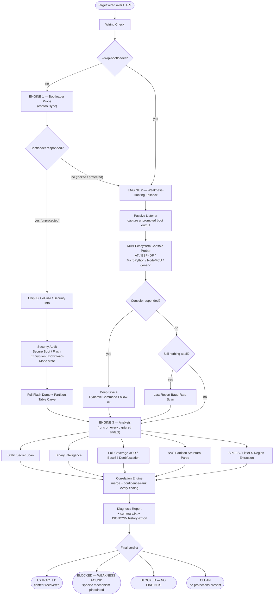

<div align="center">

# 🦅 Shahin Extractor

**A dual-engine UART extraction & firmware-security diagnostics framework for ESP8266 / ESP32 targets — built for hardware CTF competitions.**

[](https://www.python.org/)
[](LICENSE)
[]()
[]()
[]()

*Built purely on the rules of a real hardware CTF: a multimeter, a USB-TTL adapter, and jumper wires — nothing else.*

</div>

---

## Overview

**Shahin Extractor** was built for **hardware CTF (Capture The Flag) competitions** and hands-on embedded security education — the kind of environment where you're handed an unknown ESP8266/ESP32 board with a multimeter, a USB-TTL adapter, and jumper wires, and nothing else. No JTAG/SWD probe. No desoldering. No internet access to look things up mid-competition.

Rather than being a single extraction script, it's a **forensics pipeline**: it never just gives up when a target looks locked down. If the straightforward path is closed, it automatically pivots to a second line of attack and keeps looking for something exploitable — a stray debug console, a misconfigured security feature, a secret hiding in plain sight — until it can hand back either real content or a precise, reproducible explanation of the exact weakness that's blocking it.

## Key capabilities

- 🔓 **Dual-engine extraction** — a direct bootloader-level engine for unprotected targets, and an automatic fallback **Weakness-Hunting Engine** that kicks in the moment a board's security configuration (Secure Boot, Download Mode protection, Flash Encryption, ...) blocks the direct path. See [Dual-Engine Design](#dual-engine-design) below.
- 🛰️ **Multi-ecosystem console discovery** — fingerprints and talks to AT firmware, ESP-IDF consoles, MicroPython REPLs, NodeMCU/Lua, and generic/CTF-style custom shells, then does a *deep dive* and a *dynamic command follow-up* (it parses a discovered `help` menu and tries the commands it finds — exactly what a human operator would do by hand).
- 🧠 **Full-coverage secret recovery** — single-byte XOR and Base64 deobfuscation across the **entire** dump (not just a sample window), running at C-speed via precomputed translation tables: ~80–100× faster than a naive byte-by-byte scan, so nothing past the first few hundred KB gets missed.
- 🗂️ **Structural parsing, not guessing** — a real ESP-IDF NVS (non-volatile storage) partition parser, and SPIFFS/LittleFS region carving that reads actual partition-table geometry instead of blind heuristics wherever real geometry is available.
- 🔬 **Security configuration audit** — reads Secure Boot / Flash Encryption / eFuse state directly off the chip and flags exactly which protections are active, so the final report always explains *why* a path was or wasn't available.
- 🧩 **Correlation engine** — merges every finding from every stage (security audit, console probe, static analysis, binary intelligence) into one confidence-ranked list instead of a wall of disconnected log lines.
- 📋 **One unambiguous verdict, every run** — every session ends in exactly one of four states: content **extracted**, a specific weakness **pinpointed**, nothing found, or a clean/unprotected board — never a pile of logs you have to interpret yourself.
- 🧾 **Writeup-ready reporting** — a structured diagnosis report, a plain-text `summary.txt`, a per-file "what to do with this" action list, and a full session history exportable as JSON or CSV for dropping straight into a CTF writeup.
- 🛡️ **Crash-safe by design** — every captured byte hits disk immediately, with collision-proof filenames (microsecond + atomic counter) under concurrent saves; nothing is ever silently lost or overwritten, even mid-crash.
- 🧪 **Read-only by default** — any console command that could reboot, reset, erase, or reformat the target is opt-in only (`--aggressive`), so normal operation can never damage a board you can't replace.

## Dual-Engine Design

This is the heart of the project, and the reason it was built the way it was.

On a target with **no active protections**, the ROM bootloader answers directly: Shahin Extractor talks to it via `esptool`, reads the chip ID and eFuse/security state, and pulls a full flash dump. Simple, fast, done.

But a board can also come back with **Secure Boot enabled, UART Download Mode disabled, or Flash Encryption turned on** — exactly the kind of target a competition is likely to throw at you to see if you give up. This is where the second engine takes over automatically, with no extra flag needed:

1. **Passive listening** — captures anything the board says unprompted on reset (boot logs, stack traces, firmware banners).
2. **Multi-ecosystem console probing** — actively tries to fingerprint a live debug console across five+ firmware ecosystems, then deep-dives and follows up dynamically on anything that responds.
3. **Baud-rate sweep** — a last-resort scan across common baud rates, since a "silent" board is very often just a baud mismatch.

Whatever gets captured through this second engine — a boot log, a console transcript — is pushed through **the exact same analysis stage** as a full flash dump: static secret scanning, deobfuscation, NVS parsing. In other words, a locked-down board doesn't end the run — it just changes *which* engine is doing the extracting.

## Architecture



## What it detects

| Category | Examples |
|---|---|
| Security misconfiguration | Secure Boot and Flash Encryption only partially enabled, inconsistent eFuse state |
| Leftover debug surfaces | AT command sets, ESP-IDF monitor, MicroPython REPL, NodeMCU/Lua, custom/CTF shells |
| Hardcoded secrets | Wi-Fi credentials, MQTT credentials, API keys, passwords, tokens |
| Light obfuscation | Single-byte XOR, Base64-encoded payloads |
| Structured storage | NVS key/value entries, config-like blobs |
| Boot-time leakage | Stack traces, firmware/version banners, debug prints |

## Project structure

```
shahin-extractor/
├── main.py                  # CLI entry point — orchestrates the full pipeline
├── modules/
│   ├── bootloader_probe.py  # esptool sync, chip ID, eFuse/security read, full dump
│   ├── security_audit.py    # Secure Boot / Flash Encryption configuration audit
│   ├── wiring_check.py      # Sanity-checks UART wiring before anything else
│   ├── passive_listener.py  # Captures whatever the board says unprompted on boot
│   ├── console_prober.py    # Multi-ecosystem debug console probing (AT/ESP-IDF/...)
│   ├── baud_scanner.py      # Last-resort baud-rate sweep
│   ├── serial_session.py    # Shared serial I/O with deadline-respecting waits
│   ├── post_analysis.py     # strings-style scan + filesystem hints over a dump
│   ├── static_analysis.py   # Regex/JSON-aware hardcoded-secret scanning
│   ├── auto_extractor.py    # Automatic extraction of recognizable embedded content
│   ├── binary_intel.py      # Binary structure / magic-byte intelligence
│   ├── deobfuscator.py      # Full-coverage, high-speed XOR / Base64 secret recovery
│   ├── nvs_helper.py        # ESP-IDF NVS partition structural parser
│   ├── region_extractor.py  # SPIFFS/LittleFS region carving + unpacking
│   ├── correlation_engine.py# Merges all findings into a ranked result set
│   ├── diagnosis_report.py  # Renders the single final verdict + full report
│   ├── storage.py           # Crash-safe session storage (unique filenames, locking)
│   ├── logger_setup.py      # Session-scoped logging
│   └── ctf_triage.py        # Optional, off-by-default CTF-candidate pattern triage
├── boards/                  # Per-chip board profiles (ESP8266, ESP32 + variants)
├── tests/                   # unittest-based test suite
├── run_tests.py             # Canonical test runner
├── e2e_smoke.py             # Quick end-to-end sanity check against synthetic data
├── requirements.txt
└── VERSION
```

## Getting started

### Prerequisites

- Python 3.9+
- A USB-TTL (UART) adapter wired to the target board's TX/RX/GND
- Linux is recommended (serial device paths like `/dev/ttyUSB0`); also works on macOS/Windows with the appropriate port name (`/dev/tty.*`, `COM3`, ...)

### Installation

```bash
git clone https://github.com/<your-username>/shahin-extractor.git
cd shahin-extractor
python3 -m venv .venv && source .venv/bin/activate   # optional but recommended
pip install -r requirements.txt
```

> Dependencies are **pinned to exact versions on purpose**: two modules parse `esptool`/`espefuse`'s text output by matching specific phrases. Before relying on this in a competition, install the pinned versions and run the tool once against a test board to confirm chip/flash detection still populates correctly.

## Usage

```bash
# Full run against a board on /dev/ttyUSB0
python3 main.py --port /dev/ttyUSB0 --baud 115200

# Skip the bootloader stage and just listen passively for 10s
python3 main.py --port /dev/ttyUSB0 --skip-bootloader --listen-seconds 10

# Quick baud-rate sweep only, then exit
python3 main.py --port /dev/ttyUSB0 --scan-baud

# Also carve out SPIFFS/LittleFS filesystem regions as separate files
python3 main.py --port /dev/ttyUSB0 --carve-filesystems

# Export the full session history as CSV instead of JSON, for a writeup
python3 main.py --port /dev/ttyUSB0 --export csv

# Print the installed version
python3 main.py --version
```

### CLI reference

| Flag | Default | Description |
|---|---|---|
| `--port` | *(required)* | Serial port, e.g. `/dev/ttyUSB0` |
| `--baud` | `115200` | Serial baud rate |
| `--bootloader-baud` | `115200` | Baud rate for the bootloader stage specifically |
| `--flash-size` | auto-detect | Flash size for a full dump, e.g. `0x400000` for 4MB |
| `--listen-seconds` | `5.0` | How long the passive listener waits |
| `--skip-bootloader` | off | Skip the bootloader-stage attempt entirely |
| `--skip-console` | off | Skip debug-console probing |
| `--skip-dump` | off | Recon only — no full flash dump |
| `--skip-static-analysis` | off | Skip the secret/binary-intel analysis stage |
| `--carve-filesystems` | off | Also carve heuristically-detected SPIFFS/LittleFS regions as separate files |
| `--aggressive` | off | Also try console commands that could reboot/reset/erase the board |
| `--no-baud-fallback` | off | Don't auto-run a baud scan as a last resort |
| `--export` | `json` | History export format: `json` or `csv` |
| `--no-prompt` | off | Skip the "press Enter once board is in bootloader mode" pause |
| `--ctf-mode` | off | Enable optional CTF-candidate pattern triage |
| `--scan-baud` | off | Only scan common baud rates for readable traffic, then exit |

## A note on baud rate

`--baud` defaults to `115200`, which is correct for most boards' **normal
firmware/console output** — but it is not universal, and getting it wrong
is one of the most common reasons a board looks completely silent:

- **ESP8266 boards in particular** print their very first ROM boot
  messages at **74880 baud**, then switch to the firmware's own baud rate
  (often 115200) afterward. If you only see garbage or nothing right at
  boot, this is almost always why.
- Custom/CTF-built boards may deliberately run their debug UART at a
  non-standard rate as a (mild) deterrent.
- If you're not sure what a specific board uses, don't guess — run
  `python3 main.py --port /dev/ttyUSB0 --scan-baud` first. It sweeps all
  common rates (`9600, 19200, 38400, 57600, 74880, 115200, 230400, 460800`)
  and reports which one actually produces readable text. The main run also
  triggers this automatically as a last resort if nothing is found at the
  configured baud.

In short: **check — don't assume — the baud rate per board**, especially
when switching between an ESP8266 and an ESP32-family target, or between a
stock board and a custom competition PCB.

## Reporting

Every session produces:

- A **diagnosis report** with one of four clear verdicts (`EXTRACTED`, `BLOCKED_WITH_FINDINGS`, `BLOCKED_NO_FINDINGS`, `CLEAN`), the active security feature status, a confidence-ranked list of findings, and a per-file "what to do with this" action hint.
- A plain-text `summary.txt` for a quick glance.
- A full session event history (every stage, every outcome, every file produced) exportable as **JSON or CSV** — built to be dropped straight into a CTF writeup or incident report.
- Every raw artifact captured during the run (dumps, console transcripts, boot logs) preserved untouched in the session folder, nothing is ever deleted.

## Testing

```bash
python3 run_tests.py
# or
python -m pytest tests/
```

25 tests cover core functionality, regression fixes, and documented weakness fixes — see [`CHANGELOG.md`](CHANGELOG.md) for the full history.

## Tech stack

- **Language:** Python 3 (100% of the codebase)
- **Hardware interface:** [`esptool`](https://github.com/espressif/esptool) / `espefuse` (ESP bootloader & eFuse access), `pyserial` (raw UART)
- **Storage:** SQLite-backed session history, JSON/CSV export
- **Board data:** per-chip JSON profiles under `boards/`
- **Testing:** `unittest` (stdlib), `pytest`-compatible

## Scope & companion tool

Shahin Extractor covers the **ESP family** (ESP8266, ESP32, and its variants) over UART. For hardware outside that scope — external SPI/I2C memory chips and STM32-family microcontrollers over SWD/JTAG — see the companion tool, **Shahin Ext2**.

## Disclaimer

Built strictly for **educational purposes and hardware CTF (Capture The Flag) competitions**, on hardware the operator owns or is explicitly authorized to test. It performs read-only analysis by default and never attempts to break cryptography — only to find and report configuration and implementation weaknesses.

## Publishing this repo to GitHub

```bash
cd shahin-extractor
git init
git add .
git commit -m "Initial public release of Shahin Extractor"
git branch -M main
git remote add origin https://github.com/<your-username>/shahin-extractor.git
git push -u origin main
```

`.gitignore` already excludes `__pycache__/`, virtual environments, and session output, so nothing generated at runtime gets committed by accident.

## Changelog

See [`CHANGELOG.md`](CHANGELOG.md) for the full release history.

## License

MIT — see [`LICENSE`](LICENSE).
