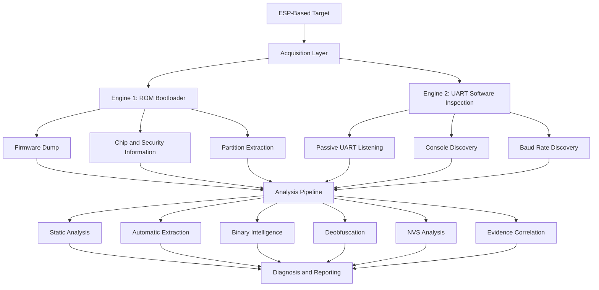

# Shahin Extractor

**Automated Firmware Acquisition, Security Assessment, and Binary Analysis for ESP-Based Devices**

Shahin Extractor is a Python-based firmware acquisition and analysis framework designed for ESP-family microcontrollers. It combines bootloader-level firmware acquisition, UART-based software inspection, automated binary analysis, security configuration assessment, and structured evidence reporting in a unified workflow.

The project is designed to help security researchers, embedded developers, and hardware CTF participants investigate firmware exposure, identify potentially sensitive information, inspect device security configurations, and organize extracted evidence for further analysis.

Rather than relying on a single extraction technique, Shahin Extractor uses two complementary acquisition engines alongside a shared analysis and reporting pipeline.

---

## Key Features

- **Dual-engine acquisition architecture** combining ESP ROM bootloader communication and UART-based software inspection.
- **Automated firmware acquisition** through the ESP ROM bootloader interface.
- **Bootloader synchronization fallback** with an alternative no-stub connection method.
- **ESP security configuration assessment** using chip security information and eFuse analysis.
- **UART console discovery** with ecosystem-aware command probing.
- **Automatic baud-rate discovery** across commonly used ESP UART speeds.
- **Firmware static analysis** including string extraction, entropy analysis, and sensitive-pattern detection.
- **Automated content extraction** for JSON, environment variables, key-value data, and Base64 candidates.
- **Binary intelligence analysis** for identifying printable regions and potentially meaningful configuration data.
- **Firmware deobfuscation** using multiple heuristic techniques.
- **NVS analysis** for extracting namespaces, entries, strings, integers, and blob data.
- **Partition table parsing and extraction** for supported ESP firmware layouts.
- **Optional filesystem carving** for SPIFFS and LittleFS-related data.
- **Evidence correlation** across multiple analysis modules.
- **Automated diagnosis reports** with ranked findings and extraction status.
- **Structured JSON, CSV, SQLite, and text-based reporting.**
- **Optional CTF-oriented candidate discovery** for security challenge workflows.

---

## Architecture

Shahin Extractor is organized around two acquisition engines and a shared analysis pipeline.



### Engine 1 — ROM Bootloader Acquisition

The first engine communicates directly with the ESP ROM bootloader through a serial interface.

Its workflow includes:

- Bootloader synchronization and connection handling.
- Automatic retry logic.
- Alternative synchronization using the no-stub mode.
- Chip identification and device information collection.
- Flash identification.
- Security configuration inspection.
- Full flash acquisition when enabled.
- Partition table parsing.
- Extraction of recognized partitions.

The engine uses `esptool` for ESP bootloader communication and integrates security inspection through the ESP tooling ecosystem.

### Engine 2 — UART Software Inspection

The second engine focuses on discovering information exposed through the device's serial interface.

It combines passive UART observation, console probing, response analysis, and baud-rate discovery.

The console prober includes ecosystem-specific handling for:

- Generic text-based consoles
- AT firmware
- ESP-IDF consoles
- MicroPython
- NodeMCU Lua
- U-Boot-like interfaces
- Common CTF-oriented interfaces

The probing workflow can capture an idle baseline, distinguish meaningful responses from background output, inspect help responses, and perform follow-up discovery based on observed console behavior.

This engine helps identify accessible software interfaces and information exposed by the target without requiring a successful firmware dump.

---

## Security Configuration Assessment

Shahin Extractor collects and analyzes device security information to provide a structured view of relevant ESP security settings.

The security assessment covers available information related to:

- Secure Boot
- Flash Encryption
- UART download restrictions
- Secure Download Mode
- Anti-rollback protection
- JTAG disable configuration
- eFuse key read and write protection
- Download command restrictions

Security states are represented using:

- `ON`
- `OFF`
- `UNKNOWN`
- `N/A`

The assessment uses chip information and eFuse-related data to organize security configuration findings.

---

## Firmware Analysis Pipeline

After firmware acquisition, the analysis pipeline processes the available binary data through multiple specialized modules.

### Static Analysis

The static analysis module examines firmware content and identifies useful indicators, including:

- Printable strings
- Potential secrets and sensitive patterns
- Entropy measurements
- Binary regions of interest
- Optional Binwalk-based analysis

### Automatic Content Extraction

The automatic extraction module searches firmware artifacts for structured and potentially useful content, including:

- JSON-like data
- Environment variables
- Key-value configurations
- Base64-encoded candidates
- Other recognizable configuration patterns

### Binary Intelligence

The binary intelligence module performs deeper inspection of binary content through:

- Printable-region identification
- Configuration candidate discovery
- Region scoring
- Prioritization of potentially relevant binary areas

### Deobfuscation

The deobfuscation module applies heuristic techniques to identify potentially recoverable content.

Implemented techniques include:

- Single-byte XOR analysis
- Base64 decoding
- Sliding-window analysis
- Confidence-based candidate evaluation

### NVS Analysis

The NVS analysis module inspects ESP-IDF Non-Volatile Storage structures.

It supports analysis of:

- NVS pages and entries
- Namespaces
- Primitive integer values
- Strings
- Blobs and blob data

This helps identify configuration values and stored information that may be relevant during firmware investigations.

### Partition and Filesystem Analysis

The partition analysis module parses supported ESP partition tables and extracts recognized partitions for further inspection.

Optional filesystem carving provides additional analysis of SPIFFS and LittleFS-related data.

### CTF-Oriented Analysis

An optional CTF mode can identify flag-like patterns and other challenge-related candidates during analysis.

This functionality is intended to assist investigation workflows by prioritizing potentially relevant content.

---

## Evidence Correlation and Diagnosis

One of the central components of Shahin Extractor is its evidence correlation and diagnosis layer.

Instead of presenting every scanner result as an isolated finding, the framework collects relevant evidence from different analysis modules and evaluates their relationship.

Evidence may originate from:

- Security configuration assessment
- UART console inspection
- Static secret scanning
- Automatic content extraction
- NVS analysis
- Deobfuscation results

The correlation layer evaluates the available evidence and assigns an assessment level:

- `STRONG`
- `PARTIAL`
- `WEAK`

The diagnosis component then generates a structured result describing the acquisition outcome and relevant findings.

Supported diagnosis verdicts include:

- `EXTRACTED`
- `BLOCKED_WITH_FINDINGS`
- `BLOCKED_NO_FINDINGS`

The resulting report can include:

- Chip identification
- Bootloader reachability
- Synchronization fallback information
- Security feature states
- Identified weakness findings
- UART console responsiveness
- Extraction path
- Ciphertext status
- Files requiring manual review
- Correlation assessment
- Ranked findings

This approach helps researchers move from raw acquisition artifacts toward a more organized understanding of the target.

---

## Reporting and Session Management

Each execution creates an organized session containing acquisition artifacts, analysis outputs, and diagnostic information.

The reporting system uses multiple output formats to support both automated processing and manual investigation.

### Output Structure

```text
session/
├── raw/
│   ├── firmware.bin
│   └── extracted_artifacts/
│
├── analysis/
│   ├── static_analysis.json
│   ├── auto_extraction.json
│   ├── binary_intel.json
│   ├── deobfuscation.json
│   ├── nvs_analysis.json
│   ├── correlation.json
│   └── diagnosis_report.json
│
├── history.sqlite3
├── history_export.json
├── summary.txt
└── session.log
```

The exact files generated depend on the acquisition path and enabled analysis options.

### Reporting Capabilities

- Per-stage JSON analysis results.
- Consolidated diagnosis report.
- Evidence correlation output.
- Ranked findings for manual review.
- SQLite-based session history.
- JSON and CSV history export.
- Human-readable execution summary.
- Raw acquisition artifacts for further investigation.

The structured output makes it possible to review findings independently, integrate results into other workflows, and preserve evidence for subsequent analysis.

---

## Supported Hardware and Communication

Shahin Extractor is designed for ESP-family devices accessible through a UART serial interface.

The project includes board profiles for multiple ESP chip families, including:

- ESP8266
- ESP32
- ESP32-C2
- ESP32-C3
- ESP32-C5
- ESP32-C6
- ESP32-C61
- ESP32-H2
- ESP32-H4
- ESP32-H21
- ESP32-P4
- ESP32-S2
- ESP32-S3
- ESP32-S31

Board profiles provide chip-specific configuration information for the framework's security assessment workflow.

### Hardware Interface

The primary communication interface is UART.

Typical connections:

| USB-UART Adapter | ESP Target |
|---|---|
| TX | RX |
| RX | TX |
| GND | GND |

Use the appropriate voltage levels for the target device and adapter.

For direct ROM bootloader acquisition, the target must be placed in its Bootloader / Download Mode when required by the chip.

---

## Requirements

- Python 3
- Linux, macOS, or Windows
- UART-compatible USB adapter
- Supported ESP target
- Required Python dependencies

### Python Dependencies

The core requirements include:

```text
pyserial==3.5
esptool==4.8.1
```

Additional utilities such as Binwalk and filesystem-related tools can be used for optional analysis features.

---

## Installation

Clone the repository:

```bash
git clone https://github.com/amirali-cheraghi-cyber/shahin-extractor.git
```

Enter the project directory:

```bash
cd shahin-extractor
```

Install dependencies:

```bash
pip install -r requirements.txt
```

---

## Usage

Run the framework with the target serial port:

```bash
python main.py --port /dev/ttyUSB0
```

On Windows, specify the appropriate COM port:

```bash
python main.py --port COM3
```

### Common Examples

Specify the serial baud rate:

```bash
python main.py --port /dev/ttyUSB0 --baud 115200
```

Skip bootloader acquisition:

```bash
python main.py --port /dev/ttyUSB0 --skip-bootloader
```

Skip console probing:

```bash
python main.py --port /dev/ttyUSB0 --skip-console
```

Skip the firmware dump:

```bash
python main.py --port /dev/ttyUSB0 --skip-dump
```

Enable filesystem carving:

```bash
python main.py --port /dev/ttyUSB0 --carve-filesystems
```

Enable CTF-oriented analysis:

```bash
python main.py --port /dev/ttyUSB0 --ctf-mode
```

Export session history:

```bash
python main.py --port /dev/ttyUSB0 --export
```

Scan common UART baud rates:

```bash
python main.py --port /dev/ttyUSB0 --scan-baud
```

---

## Command-Line Options

| Option | Description |
|---|---|
| `--port` | Serial port connected to the target |
| `--baud` | UART baud rate |
| `--bootloader-baud` | Bootloader communication baud rate |
| `--flash-size` | Flash size configuration |
| `--listen-seconds` | Passive UART listening duration |
| `--skip-bootloader` | Skip the bootloader acquisition stage |
| `--skip-console` | Skip console probing |
| `--skip-dump` | Skip full flash dumping |
| `--skip-static-analysis` | Skip the static and related binary-analysis pipeline |
| `--carve-filesystems` | Enable optional filesystem carving |
| `--aggressive` | Enable additional potentially disruptive console commands |
| `--no-baud-fallback` | Disable automatic baud fallback |
| `--export` | Export session history |
| `--no-prompt` | Skip the interactive bootloader-mode confirmation |
| `--ctf-mode` | Enable CTF-oriented candidate discovery |
| `--scan-baud` | Scan supported common UART baud rates |

---

## Project Structure

```text
shahin-extractor/
│
├── main.py
├── requirements.txt
├── README.md
│
├── boards/
│   └── ESP board profiles
│
├── engines/
│   └── Acquisition engines
│
├── modules/
│   ├── Static analysis
│   ├── Automatic extraction
│   ├── Binary intelligence
│   ├── Deobfuscation
│   ├── NVS analysis
│   ├── Partition analysis
│   └── Evidence correlation
│
└── reporting/
    └── Diagnosis and reporting components
```

---

## Development Status

Shahin Extractor is an actively developing project.

The current implementation brings together firmware acquisition, UART inspection, security assessment, binary analysis, evidence correlation, and structured reporting in one workflow.

Future development will focus on improving analysis depth, expanding discovery capabilities, refining the acquisition workflow, and strengthening reporting and usability.

The project is intended to evolve through continued development and new releases.

---

## Responsible Use

Shahin Extractor is intended for authorized security research, firmware analysis, embedded-device assessment, educational purposes, and CTF environments.

Only use the framework on devices you own or have explicit permission to assess.

Some console commands, particularly when aggressive probing is enabled, may cause a target device to restart or modify its state. Use appropriate care when working with production hardware.

---

## License

This project is distributed under the MIT License. See the `LICENSE` file for details.
